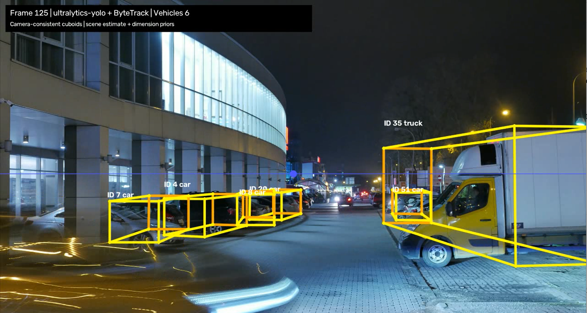

# Monocular 3D Vehicle Tracking

A Python pipeline that detects and tracks vehicles in a fixed-camera video and draws 3D boxes on them. It uses YOLOv8n for detection, ByteTrack for tracking, and a simple flat-ground camera model for the 3D part.



*Example output. The boxes are approximate and get worse when vehicles overlap.*

There's no camera calibration. The pipeline guesses the camera setup from the video itself (road lines or vehicle positions) and falls back to fixed assumptions when that isn't enough. The 3D boxes look right in the image, but they are not real-world measurements. One camera can't give you that.

## How it works

1. Detect vehicles in each frame with YOLOv8n.
2. Track them across frames with ByteTrack so each one keeps an ID.
3. Estimate the horizon and camera from the first 45 frames.
4. Place each vehicle on the ground plane and fit a 3D box to its 2D detection.
5. Smooth each box over time. If a fit looks wrong, show a plain 2D box marked uncertain.

Vehicle sizes, camera height and field of view are fixed assumptions, not measured values.

## Setup

Tested on Windows with Python 3.14 and CPU only.

```
py -3.14 -m venv .venv
.\.venv\Scripts\python.exe -m pip install -r requirements-lock-win-cpu.txt --extra-index-url https://download.pytorch.org/whl/cpu
.\.venv\Scripts\python.exe scripts/download_model.py
```

## Run it

This repo has no videos and no sample clips. Use your own footage.

Put your clip at `data/input.mp4`, or pass any path with `--input`:

```
.\.venv\Scripts\python.exe run_demo.py --input data/input.mp4 --output outputs/output.mp4 --snapshot outputs/output.jpg --max-frames 90
```

Try a short run first, then remove `--max-frames` to process the whole video. Add `--show` for a live preview. You get an annotated video, a snapshot image, and per-frame results.

## Limitations

- Boxes are not real-world 3D measurements.
- Fixed camera only.
- About 31% of tracked vehicle-frames on my test clip failed the fit check and fall back to 2D boxes.
- Lens distortion isn't modeled, and smoothing can lag.
- Only tested on Windows, Python 3.14, CPU. No GPU testing.

## Tests

```
.\.venv\Scripts\python.exe -m pytest -q
```

85 tests pass. They check the code behaves correctly, not that the 3D estimates are accurate.

## Code layout

- `detectors.py`: YOLO detection and filtering
- `tracker.py`: ByteTrack tracking
- `geometry.py`: camera estimate, ground placement, box fitting
- `renderer.py`: drawing boxes and labels
- `pipeline.py`: video in, results out